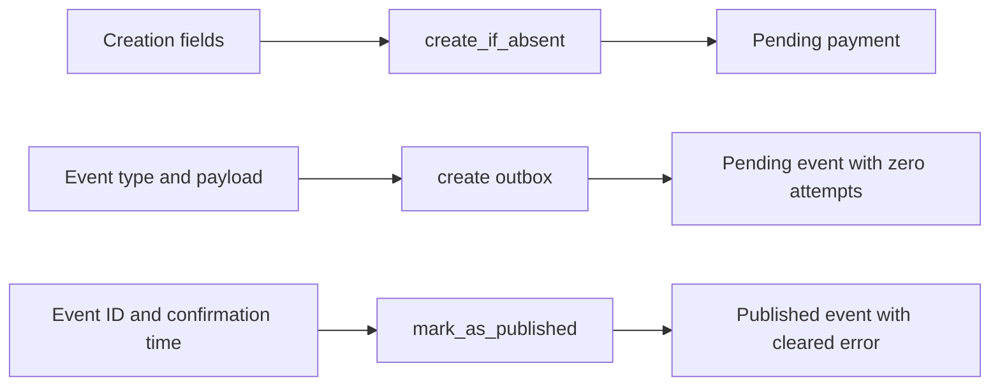

# ADR 0001: Keep storage commands specific to workflow intentions

Status: Implemented; PR review pending.

## Context

The payment workflow already has a small interface for its callers: the consumer
executes one payment attempt, and the relay recovers an expired attempt. Its
durability requirements need visible transaction boundaries around claim,
gateway persistence, webhook reservation and completion.

The storage interfaces also retained operations from the earlier implementation:
payment `create`, unrestricted `update_by_id`, and outbox `mark_as_failed`.
Only their own legacy storage tests called these methods. They exposed a second
creation path, mutable creation fields, unfenced status writes, and terminal
publication failure alongside the current durable retry workflow.

Creation and publication DTOs made callers repeat state that those operations
already imply: pending payments, pending outbox events with zero attempts, and
published events with cleared errors.

## Decision

Remove the unused write operations and their DTOs. Keep the existing use cases,
explicit transaction boundaries and specialized fenced storage transitions.
Payment storage has nine operations; outbox storage has four.

Make command parameters describe caller choices. The storage interface defines
each operation's fixed outcome, and its SQL adapter applies that contract:

| Command | Caller supplies | Operation guarantees |
| --- | --- | --- |
| `CreatePayment` | Creation fields and idempotency key | A newly inserted payment is `pending` |
| `CreateOutbox` | Event type and payload | `pending`, zero attempts, no error or publication timestamp |
| `MarkOutboxAsPublished` | Event ID and publication timestamp | `published`, previous error cleared |

The SQL adapter still executes one query per storage method. Application use
cases retain payment/outbox atomicity and external calls outside transactions.
Historical `OutboxStatus.FAILED` remains readable; this decision removes its
unused write operation, without changing the PostgreSQL enum or migration chain.

## Alternatives considered

- A combined execution module with an internal transaction journal would collect
  persistence rules, but its callers already have one entry point each. A new
  layer would need to justify its additional interface and dependency wiring.
- A pure event/command state machine would help add processing stages, but this
  workflow is linear. It would add a dispatcher and intermediate types while
  retaining the same persistence ordering and uncertainty handling.

## Consequences

Callers cannot choose an initial business status, create an already-published
outbox event, or change creation fields through a generic update operation.
The remaining operations expose the actual supported workflow.

The processing use case remains explicit about sequencing and transaction
boundaries. SQL fencing, shared attempt budget, retry queues, recovery, API
responses and deployment requirements retain their existing contracts.

Internal callers must use the narrowed command constructors. Tests exercise
creation through `create_if_absent`, terminal-result protection through
`save_gateway_result`, and publication failures through `reschedule`. Existing
concurrency, TTL/DLX, unknown-commit and real-process recovery tests remain.
